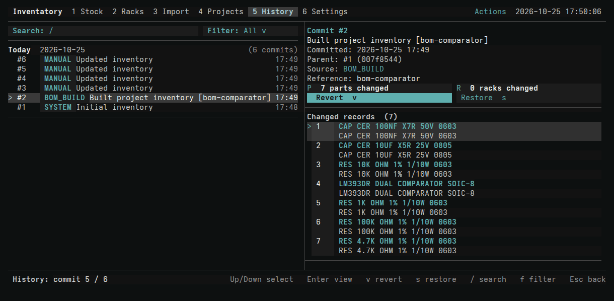

**Open-source, terminal-based hardware inventory management for PCB designers.**

Track your hardware components in a fast terminal UI. Designed so that most of the work is automated.
Features a 3D printable rack system, label printing, the 'Inventatory Scanner R1' device and much more.

[**Website**](https://kwiatens.github.io/Inventatory-Site/) &nbsp;·&nbsp;
[Scanner Firmware](https://github.com/Kwiatens/Inventatory-Firmware) &nbsp;·&nbsp;
[Documentation](https://kwiatens.github.io/Inventatory-Site/docs/) &nbsp;·&nbsp;
[Report an issue](https://github.com/Kwiatens/Inventatory-Software/issues)

> **New here?** Visit the [Inventatory website](https://kwiatens.github.io/Inventatory-Site/) - it's a great place to start.
> You can explore what the project can do and find the documentation and instructions there.

## Core features of the system

### 1. Automation is the priority

Everything inside Inventatory was designed to be automated and operate quickly as possible. 
Your job is designing and working on your projects, not baby-sit your inventory. It defeats the whole purpose as it's supposed to save you time.

It automatically:
- Assigns every single parameter (name, type, electrical parameters, datasheet links, pricing and purchase link, etc) of the part.
- Matches parts to your PCB BOM from KiCad, EasyEDA or Altium Designer, based on the electrical parameters. When a part is not in your inventory, it will search for a part that matches what you need for the best price, from your preferred supplier.
- Puts your parts on available racks and slots in that racks, for the exact part positioning.
- Generates and prints the label that goes on each storage tube, with all the information about a part.
- Creates shopping lists that you can put directly to your vendor.
- And much more!

### 2. Each part gets assigned to it's own unique storage location

Instead of manually assigning every single component to a random box, which doesn't really solve anything - Inventatory uses our 3D-printable storage rack system. Racks allow to have unique location for each and every part, meaning the software can tell you where your parts are **precisely**.

This means that when you then upload your BOM (Bill of materials) of your PCB - it will give you not only if you have the needed parts, but also on **which exact rack and slot they are at**, so you can just grab the highlighted tubes and get going.

> The assigment work, as well as pretty much everything in our system is fully automated - that's the best part!

### 3. Search by electrical parameters, not only part names

A common problem with inventory systems is that they are not purpose build for electronics. You might type 100nF in the search function, and nothing will pop-up, even though the part is actually there, just marked as 0.1uF. Inventatory solves this, by searching for parts by their physical electrical parameters, not just names.

### 4. It keeps you changes in check, just like git

Every change is saved as a commit with its before and after values, like a git history for your parts. You can
see exactly what changed, set checkpoints, restore a whole snapshot, or revert a single change while keeping
everything since.

## We have a purpose-built, DiY-able scanner too!

It's designed specyfically for this system. It allows you to modify the quantity of a part you're actively working with, without having to fiddle around with your PC during PCB work, which from experience is very frustrating.

It's main purpose is allowing you to just scan a QR code on the generated label that's on the part container, and then deduct or add quantity to that exact part with just two clicks on the scanner.

You can also use it to scan vendor bags or send jobs to your label printer.

> **[Scanner firmware and build guide →](https://github.com/Kwiatens/Inventatory-Firmware)**

Inventatory works fully without the scanner. It just makes the intake faster.

## Install

### Windows

Open Command Prompt and paste:

    curl.exe -fL "https://github.com/Kwiatens/Inventatory-Software/releases/latest/download/Install-Inventatory.ps1" -o "%TEMP%\Install-Inventatory.ps1" && powershell.exe -NoProfile -ExecutionPolicy Bypass -File "%TEMP%\Install-Inventatory.ps1" && del /q "%TEMP%\Install-Inventatory.ps1"

### Linux

    mkdir -p "$HOME/.cache/inventatory-installer" && cd "$HOME/.cache/inventatory-installer" && curl -fLO "https://github.com/Kwiatens/Inventatory-Software/releases/latest/download/Inventatory-linux-x64.tar.gz" && curl -fLO "https://github.com/Kwiatens/Inventatory-Software/releases/latest/download/SHA256SUMS-linux.txt" && curl -fLO "https://github.com/Kwiatens/Inventatory-Software/releases/latest/download/Install-Inventatory.sh" && chmod +x Install-Inventatory.sh && ./Install-Inventatory.sh

Then run `$HOME/.local/bin/inventatory`.

Linux requirements

The [getting started guide](https://kwiatens.github.io/Inventatory-Site/docs/) walks you through your first
inventory.

<picture>
  <source media="(prefers-color-scheme: light)" srcset="branding/readme/roadmap-light.svg">
  
</picture>

## Building from source

Build with CMake 3.20 or newer and a C++17 compiler, then run the tests with
`ctest --test-dir <build-dir> --output-on-failure`. Dependencies and contribution rules are in
[CONTRIBUTING.md](CONTRIBUTING.md).

Project documentation

- [CONTRIBUTING.md](CONTRIBUTING.md): how to contribute.
- [SECURITY.md](SECURITY.md): private vulnerability reporting and the security scope.
- [docs/architecture.md](docs/architecture.md): code layout, threading, persistence and security invariants.
- [AGENTS.md](AGENTS.md): the guide for coding agents.
- [docs/project-standards.md](docs/project-standards.md): rules shared with the Scanner R1 firmware repository.
- [docs/releasing.md](docs/releasing.md): release steps and repository settings.
- [CHANGELOG.md](CHANGELOG.md): what changed in each version.
- [THIRD_PARTY_NOTICES.md](THIRD_PARTY_NOTICES.md): licenses of bundled dependencies.

## License

Inventatory is licensed under GPL-3.0-only. See [LICENSE.md](LICENSE.md) for the project notice.
