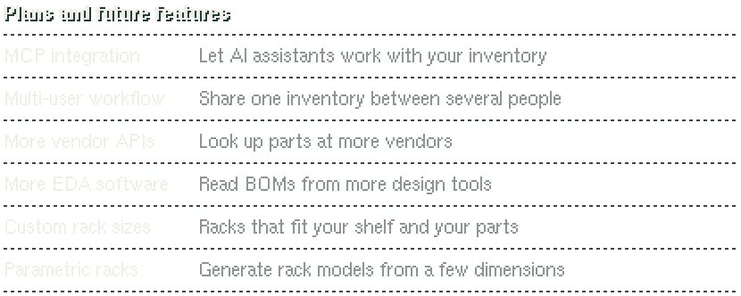

**Open-source, terminal-based hardware inventory management for PCB designers.**

Track your hardware components in a fast terminal UI. Designed so that most of the work is automated.
Features a 3D printable rack system, label printing, the 'Inventatory Scanner R1' device and much more.

[**Website**](https://kwiatens.github.io/Inventatory-Site/) &nbsp;·&nbsp;
[Documentation](https://kwiatens.github.io/Inventatory-Site/docs/) &nbsp;·&nbsp;
[Report an issue](https://github.com/Kwiatens/Inventatory-Software/issues)

---
> **New here?** The [Inventatory website](https://kwiatens.github.io/Inventatory-Site/) is a great place to start.
> There you can explore what the project can do and find the documentation and instructions.

> **Current version:** public beta (`0.1.4`, see [CHANGELOG.md](CHANGELOG.md)).

## Install on Windows

Open Command Prompt and paste the following command to download and install the
latest stable release for the current Windows user:

    curl.exe -fL "https://github.com/Kwiatens/Inventatory-Software/releases/latest/download/Install-Inventatory.ps1" -o "%TEMP%\Install-Inventatory.ps1" && powershell.exe -NoProfile -ExecutionPolicy Bypass -File "%TEMP%\Install-Inventatory.ps1" && del /q "%TEMP%\Install-Inventatory.ps1"

## Install on Linux

On Ubuntu 24.04:

    mkdir -p "$HOME/.cache/inventatory-installer" && cd "$HOME/.cache/inventatory-installer" && curl -fLO "https://github.com/Kwiatens/Inventatory-Software/releases/latest/download/Inventatory-linux-x64.tar.gz" && curl -fLO "https://github.com/Kwiatens/Inventatory-Software/releases/latest/download/SHA256SUMS-linux.txt" && curl -fLO "https://github.com/Kwiatens/Inventatory-Software/releases/latest/download/Install-Inventatory.sh" && chmod +x Install-Inventatory.sh && ./Install-Inventatory.sh

Run it with
`$HOME/.local/bin/inventatory`. See [Linux support](docs/linux-support.md) for
runtime dependencies, scanner access, data locations, and native build steps.

The whole system is **designed to be fast, and require as little user input as possible** - so that you can focus on your job, and not on micromanaging your inventory.

<picture>
  <source media="(prefers-color-scheme: light)" srcset="branding/readme/roadmap-light.svg">
  
</picture>

Key features:
- The system automatically assigns each part to a specific slot on each 3D-printable rack, so later it can give you the precise location of it, not just generic 'Drawer 12'.
- Integration with popular EDA software - it automatically compares your inventory with the BOM of your PCB, and points out precisely on which rack and slot each component lives.
- A DIY-able hardware scanner, the Inventatory Scan R1, for reading vendor part bags and the Inventatory QR codes on the SMD tubes in the racks.
- Direct integration with the most popular electronics part vendors (such as DigiKey).
- ZPL Label Printer integration for the tubes that go on 3D printable storage racks.
- Search by electrical parameters, not only by name! Electrical parameters are applied automatically too, from the vendor's API.

## Building and testing

Build with CMake 3.20 or newer and a C++17 compiler, then run `ctest --test-dir <build-dir> --output-on-failure`.
The core tests are one program, `inventatory_tests`; run `inventatory_tests --list` to see its tests and
`inventatory_tests --filter <text>` to run only the ones whose name contains the text. The exact build commands
are in [docs/public-beta.md](docs/public-beta.md) and the Linux test notes in
[docs/linux-support.md](docs/linux-support.md#running-the-tests).

## Documentation

- [CONTRIBUTING.md](CONTRIBUTING.md): how to contribute.
- [SECURITY.md](SECURITY.md): private vulnerability reporting and the security scope.
- [AGENTS.md](AGENTS.md): architecture, invariants and verification rules, also the guide for coding agents.
- [docs/project-standards.md](docs/project-standards.md): rules shared with the Scan R1 firmware repository.
- [docs/scanner-transport-security.md](docs/scanner-transport-security.md): the Scan R1 transport protocol.
- [docs/releasing.md](docs/releasing.md): release steps and repository settings.
- [CHANGELOG.md](CHANGELOG.md): what changed in each version.
- [THIRD_PARTY_NOTICES.md](THIRD_PARTY_NOTICES.md): licenses of bundled dependencies.

## License

Inventatory is licensed under GPL-3.0-only. Each release package includes the complete license text; see [LICENSE.md](LICENSE.md) for the project notice.
