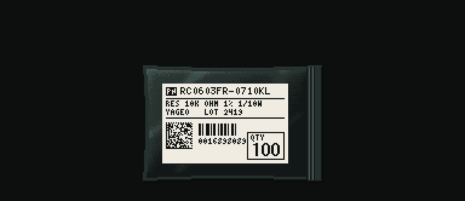
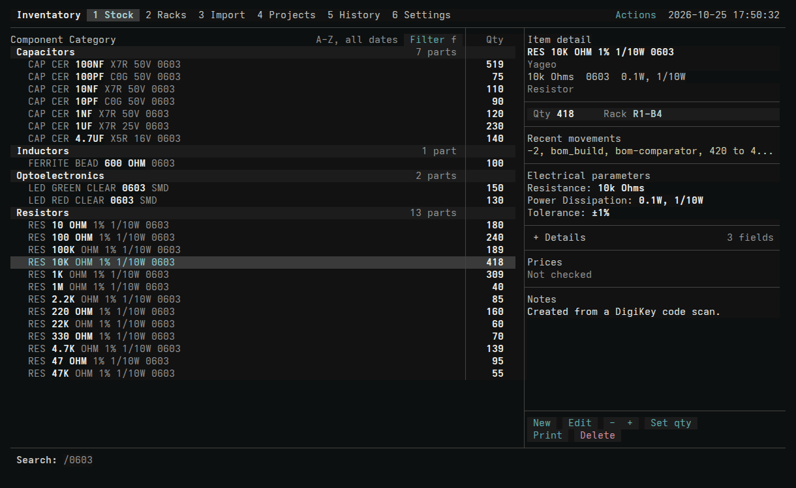
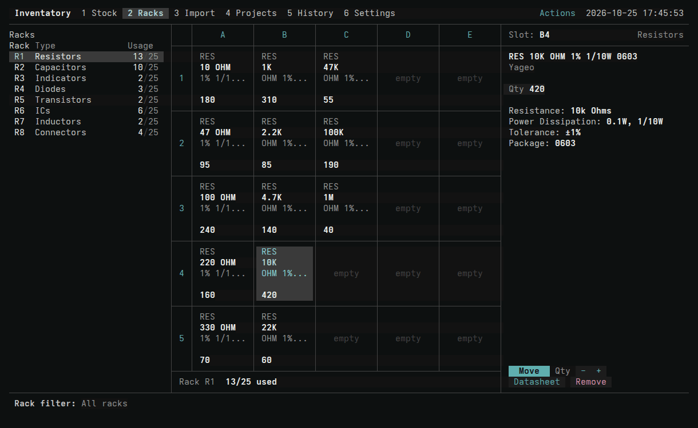
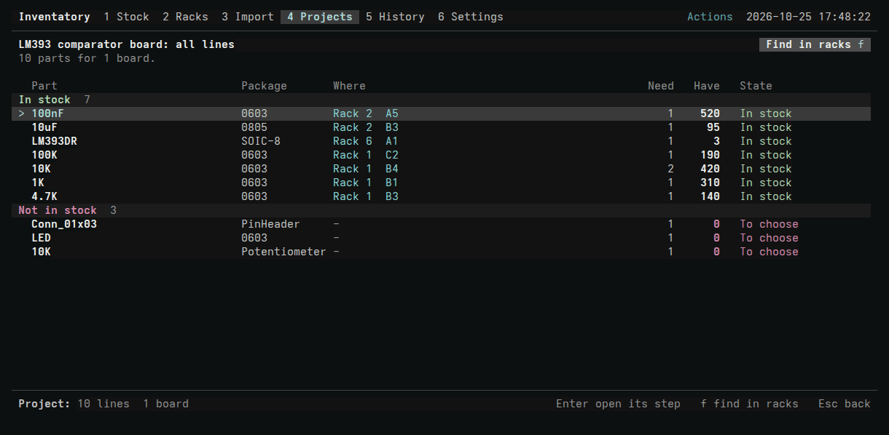
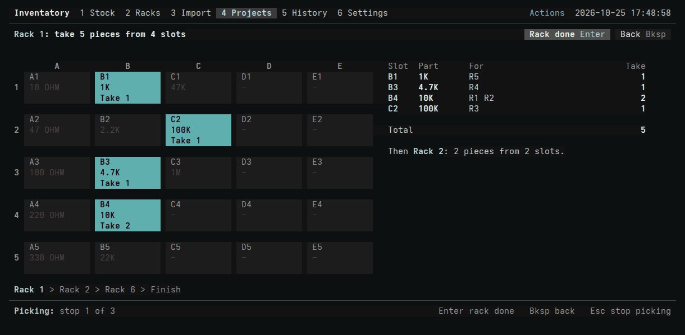
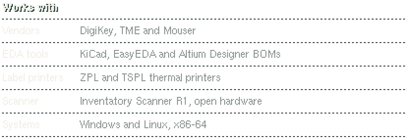

### Every part has a place.

**A free, open-source inventory for electronic components, built for people who design and build PCBs.** 
Scan a vendor bag and the part is filled in, labelled and given a slot.
Import a board's BOM and Inventatory finds what you have, buys what you don't, and walks you to every part.

[**Website**](https://kwiatens.github.io/Inventatory-Site/) &nbsp;·&nbsp;
[Install](#install) &nbsp;·&nbsp;
[Documentation](https://kwiatens.github.io/Inventatory-Site/docs/) &nbsp;·&nbsp;
[Scanner firmware](https://github.com/Kwiatens/Inventatory-Firmware) &nbsp;·&nbsp;
[Report an issue](https://github.com/Kwiatens/Inventatory-Software/issues)

 

---

> **Status:** public beta (`0.1.7`). See [CHANGELOG.md](CHANGELOG.md) for what changed in each version.

## What it is

Inventatory is a parts inventory for hobbyists, makers, small labs and engineers doing prototypes and R&D. It is
made of four pieces that work as one system:

- **A desktop app** that runs in your terminal on Windows and Linux. It is fast, keyboard-first, and works with the
  mouse too.
- **3D-printable racks** with a 5 × 5 grid, so every part has an exact address like `R1-B3`.
- **Label printing** on ZPL and TSPL thermal printers, for parts, slots and cable flags.
- **The Inventatory Scanner R1**, an open-hardware handheld scanner that reads vendor bags at the bench.

Most inventory tools are a list of parts you type in by hand. Inventatory covers the whole path, from the
vendor's bag to the finished board.

## How it works

### 1. Scan it in

Scan the code on a DigiKey, TME or Mouser bag, or load an order CSV. Inventatory reads the vendor's code, looks
the part up at that vendor and fills in its name, parameters, package, datasheet and price. A label prints and the
part is given a free slot. You don't type anything.

### 2. Give it a place

Every part lives in a rack slot, so its location reads `R1-B4`, not "the drawer with the resistors". The racks
show what is in each slot and how much is left, and parts that run low are flagged before you run out.

### 3. Build a board

Import a BOM from KiCad, EasyEDA or Altium Designer. Inventatory matches every line against your stock and shows
what you have, where it is, and what is missing.

For the parts you don't have, it searches your preferred vendor, and the others when that vendor doesn't stock
the part. It finds parts that match what the BOM line needs (value, package and parameters), picks the best deal,
and marks end-of-life parts so you don't design them in. Order saves a ready cart file for each vendor, and
Receive puts the delivery straight into stock and onto a slot.

When it's time to build, **Find in racks** takes you rack by rack and lights up the slots to pick from. At the end
it subtracts what you took from stock.

## Why exact places matter

 

|  | Spreadsheet | Typical inventory app | Inventatory |
| --- | --- | --- | --- |
| **Adding a part** | Typed by hand | Typed by hand, sometimes a vendor lookup | One scan of the bag: details, label and slot |
| **Where it is** | A free-text note | A location field | An exact rack slot, shown on a grid |
| **Building a board** | Compare the BOM yourself | Shows shortages | Matches the BOM, then walks you slot by slot |
| **Buying what's missing** | Search each vendor yourself | Links to vendors | Finds matching parts at your vendors, picks the best deal, saves the cart |
| **Mistakes** | Ctrl+Z until you close the file | Edit it back by hand | Every change kept, any change reverted |
| **Your data** | A file | Usually a server or a cloud account | A local database on your computer |

## Nothing is lost

Every change is saved as a commit with its before and after values, like a git history for your parts. You can
see exactly what changed, set checkpoints, restore a whole snapshot, or revert a single change while keeping
everything since. Ctrl+Z works even after a restart.

## The Scanner R1

The Scanner R1 is a handheld scanner made for Inventatory. Point it at a vendor bag and the part is added or found,
and its label prints. Change the quantity on its keypad. You stay at the bench instead of walking back to the
computer for every bag.

It also prints cable-flag labels from presets, keeps scans safe when the PC is away, and pairs securely with your
computer. The firmware, wiring and build guides are open source, and the enclosure and charging dock are designed
for 3D printing.

**[Scanner firmware and build guide →](https://github.com/Kwiatens/Inventatory-Firmware)**

Inventatory works fully without the scanner. It just makes the intake faster.

 

<picture>
  <source media="(prefers-color-scheme: light)" srcset="branding/readme/works-with-light.svg">
  
</picture>

## Your data stays yours

- **Local.** Your inventory is a database on your own computer. There is no account, no server and no
  subscription.
- **Safe.** Backups are checked before they are written, and a restore is all or nothing.
- **Private keys stay private.** Vendor API keys are kept in the system's credential store (Windows Credential
  Manager, or the Secret Service on Linux), never in a file.
- **Free.** Inventatory is open source under GPL-3.0.

## Install

### Windows

Open Command Prompt and paste:

    curl.exe -fL "https://github.com/Kwiatens/Inventatory-Software/releases/latest/download/Install-Inventatory.ps1" -o "%TEMP%\Install-Inventatory.ps1" && powershell.exe -NoProfile -ExecutionPolicy Bypass -File "%TEMP%\Install-Inventatory.ps1" && del /q "%TEMP%\Install-Inventatory.ps1"

### Linux

    mkdir -p "$HOME/.cache/inventatory-installer" && cd "$HOME/.cache/inventatory-installer" && curl -fLO "https://github.com/Kwiatens/Inventatory-Software/releases/latest/download/Inventatory-linux-x64.tar.gz" && curl -fLO "https://github.com/Kwiatens/Inventatory-Software/releases/latest/download/SHA256SUMS-linux.txt" && curl -fLO "https://github.com/Kwiatens/Inventatory-Software/releases/latest/download/Install-Inventatory.sh" && chmod +x Install-Inventatory.sh && ./Install-Inventatory.sh

Then run `$HOME/.local/bin/inventatory`.

Linux requirements

Any x86-64 Linux distribution with glibc 2.34 or newer should work. The release is tested on Ubuntu 22.04,
Debian 12, AlmaLinux 9 (a RHEL 9 rebuild) and Fedora 44. It also needs OpenSSL 3, libsecret, libcurl and a
Secret Service provider (GNOME Keyring or KWallet) to store tokens.

The [getting started guide](https://kwiatens.github.io/Inventatory-Site/docs/) walks you through your first
inventory.

<picture>
  <source media="(prefers-color-scheme: light)" srcset="branding/readme/roadmap-light.svg">
  
</picture>

## Building from source

Build with CMake 3.20 or newer and a C++17 compiler, then run the tests with
`ctest --test-dir <build-dir> --output-on-failure`. Dependencies and contribution rules are in
[CONTRIBUTING.md](CONTRIBUTING.md).

Project documentation

- [CONTRIBUTING.md](CONTRIBUTING.md): how to contribute.
- [SECURITY.md](SECURITY.md): private vulnerability reporting and the security scope.
- [docs/architecture.md](docs/architecture.md): code layout, threading, persistence and security invariants.
- [AGENTS.md](AGENTS.md): the guide for coding agents.
- [docs/project-standards.md](docs/project-standards.md): rules shared with the Scanner R1 firmware repository.
- [docs/releasing.md](docs/releasing.md): release steps and repository settings.
- [CHANGELOG.md](CHANGELOG.md): what changed in each version.
- [THIRD_PARTY_NOTICES.md](THIRD_PARTY_NOTICES.md): licenses of bundled dependencies.

## License

Inventatory is licensed under GPL-3.0-only. See [LICENSE.md](LICENSE.md) for the project notice.
